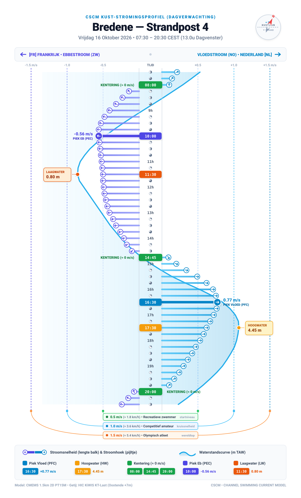
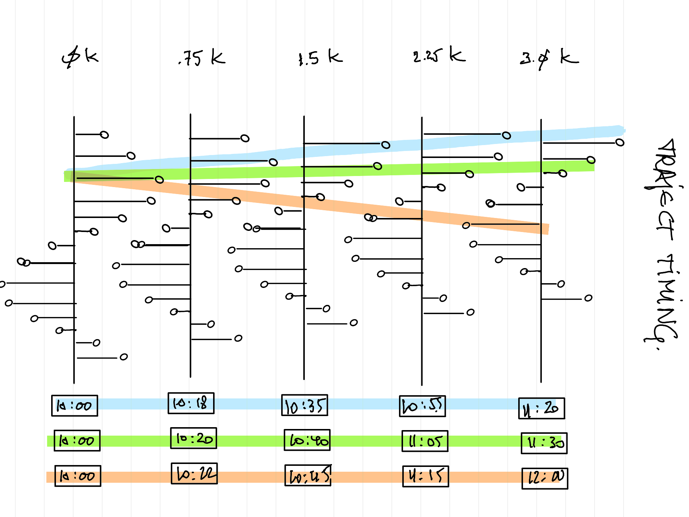
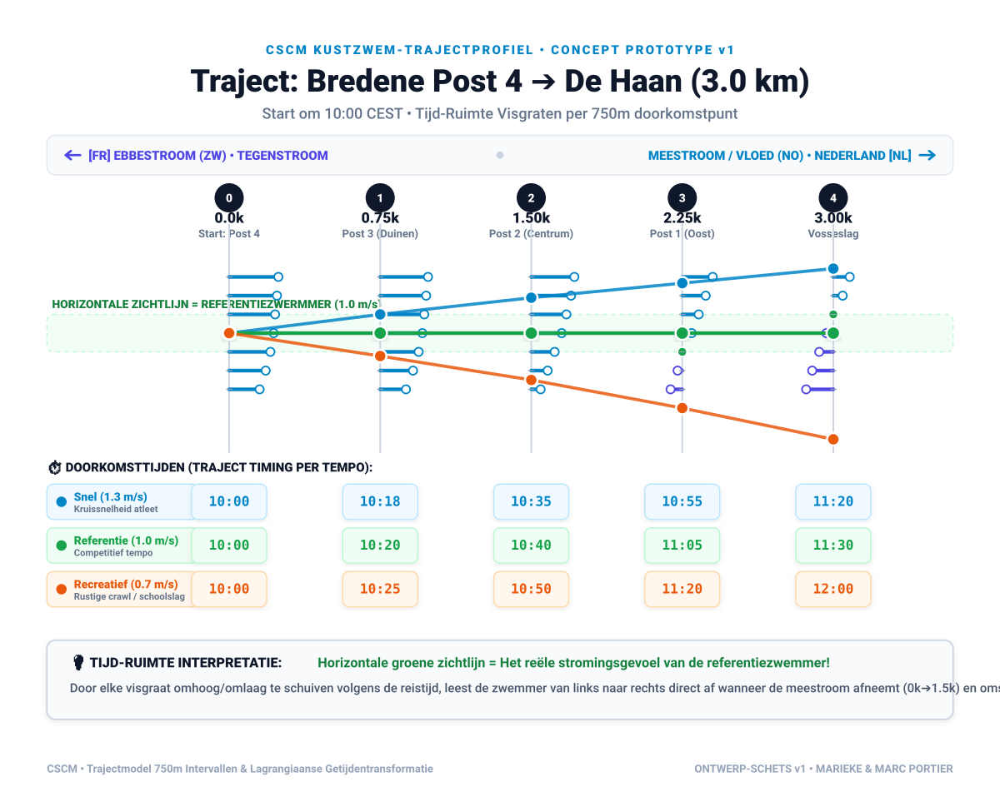

# CSCM Roadmap & Engineering Plans

This document outlines the ordered development roadmap for the **Channel Swimmer Crossing Module (CSCM)**. It anchors technical development to an operational monthly calendar.

---

## 🗓️ Operational Development Timeline

| Timeline | Milestone & Focus | Key Deliverables |
| :--- | :--- | :--- |
| **Oct 2026** | **Stabilization & Clean Core** | Refactoring, code cleanup, unified CLI & logging, automated `pytest` test harness with synthetic fixtures. |
| **Nov – Dec 2026** | **CMEMS Analysis & Empirical Validation** | Extensible spatial analysis pipeline, incremental cache, and retrofitting actual swim GPS tracks to isolate localized model residuals. |
| **Jan 2027** | **Tidal Synthesis Pipeline** | Construction of neutral, non-time-bound normalized 2D hydrodynamic tensors and metadata manifests for multi-year projections. |
| **Feb 2027** | **Harmonized `CurrentsModel` Subsystem** | Unified interface spanning historical archives, live forecast windows, and long-range synthesized fields with dynamic time-scaling. |
| **Mar 2027** | **Swimmer Kinematics & Fatigue Decay** | Empirical pace decay curves ($v(t)$), heading variance under fatigue and wave action, and relay team kinematics. |
| **Apr 2027** | **Spatiotemporal Trajectory Optimization** | Space-time graph search (`TrajectoryFinder`) to discover optimal departure windows and dynamic steering angles across lunar cycles. |
| **May 2027** | **Operational Campaign Automation** | Enhanced YAML job configurations and tuned automated briefing mailers tailored for recurring seasonal coastal swim operations. |
| **Jun – Sep 2027** | **Online Client-Side Planner (Prototype)** | First working draft of a cloud-native, browser-based routing tool powered by DuckDB-Wasm and compressed data formats. |

---

## Detailed Milestone Descriptions

### Milestone 1 (October 2026): Stabilization, Refactoring & Test Harness

* **1.1 Catalog-Based NetCDF Selector**:
  * Refactor `get_latest_forecast_nc` in `predict.py` to query `CMEMSDataManager.catalog` for exact date range overlaps (`data_start_dt` / `data_end_dt`), unlocking historical simulations and offline test suites.
* **1.2 Code Convergence & Shared Infrastructure**:
  * Unify the historically separate code paths (`model.py`, `current/cmems`, and `simulation`).
  * Introduce a shared `cscm.cli` / `cscm.config` module for common arguments (`--log-level`, `--data-dir`, `--config`) and standardized logging to both stdout and [cscm.log](../cscm.log).
  * Refactor `CmemsForecastCurrentsModel` to implement the abstract [CurrentsModel](../src/cscm/model.py#L264) interface.
  * Refactor `simulate_test_swim` to run through [TrajectoryCalculator](../src/cscm/model.py#L343) driving a concrete [Swimmer](../src/cscm/model.py#L204) instance.
* **1.3 Automated Test Suite**:
  * Establish a robust `pytest` suite under `tests/`:
    * Vector algebra, coordinate translations, heading trigonometry, WKT geometry loaders, and YAML job schema validation.
    * Algorithmic validation of `find_daily_tide_peaks` dead-time filtering against synthesized velocity signals.
    * Mock hydrodynamics: a lightweight synthetic NetCDF fixture to test spatio-temporal bilinear interpolation without loading heavy data files.

---

### Milestone 2 (November – December 2026): CMEMS Analysis & Empirical Validation

* **2.1 Extensible Analysis Pipeline**:
  * Restructure `analyse.py` into a modular, task-based engine where new physical diagnostics can be registered as discrete pipeline steps.
  * Support granular CLI flags and YAML configurations to enable or disable specific analysis passes selectively.
* **2.2 Incremental Analysis Cache**:
  * Implement hash-based caching (NetCDF file hash/mtime + cellid + parameter signature) to allow sparse cell analysis (ie target focal points only) and skip recalculating unchanged grid cells and lunar cycles.
* **2.3 Hydrodynamic Insight & Sanity Checks**:
  * Map spatial progression of the spring tide lag (tidal age) across coastal and shelf waters for the analysed region.
  * Better time analysis (alternatives, sine - or at least period - time fitting verification, ...) and extended detection types: not only PFC and PEC but also ZRO 'zero' (mid-cycle crossings, note: maybe best interpolated between the max, as detection in the data suffers from noise near zero), and classification of those moments into subgroups Z2F and Z2E (zero-to-flood vs zero-to-ebb). 
  * Visualize age and tidal progression timings in the geographic region of interest. Relate it to time of the moon cycles (neap-spring extremes), tidal extremes (peak currents) and local landmarks. Make it an animated visualization, not just images.
  * Quantify shoreline friction decay, shallow-water sandbank accelerations, and slack water reversal stability relative to the nearest coast.
  * Validate velocity time series against coastal tide gauge networks.
* **2.4 Empirical Swim Data Retrofitting**:
  * Ingest real-world GPX tracks and sensor logs from completed experimental swims.
  * Overlay observed drift against predicted trajectory vectors to isolate and quantify localized hydrodynamic discrepancies in the 1.5 km model.

---

### Milestone 3 (January 2027): Tidal Synthesis Pipeline (Neutral Normalized Model)

* **3.1 Overcoming the 7-Day Forecast Horizon**:
  * CMEMS provides high-accuracy 7-day operational forecasts, but long-range campaign planning requires projections months or years in advance.
  * Because tidal hydrodynamics are deterministically driven by celestial mechanics, historical archives can be synthesized into a canonical, normalized tidal dataset.
* **3.2 Dual-Phase Normalization**:
  * Map linear time $t$ into a two-dimensional astronomical phase space:
    1. Semi-diurnal tidal phase: $\phi_{\text{tide}} \in [0, 2\pi)$ (principal lunar period $M_2 \approx 12.4206\text{h}$).
    2. Synodic lunar cycle phase: $\phi_{\text{moon}} \in [0, 2\pi)$ (spring-neap envelope $\approx 29.5306\text{d}$).
  * Construct a normalized spatiotemporal velocity tensor:
    $$V_{\text{norm}}(x, y, \phi_{\text{tide}}, \phi_{\text{moon}})$$
* **3.3 Statistical Aggregations & Envelopes**:
  * Compute the median flow field representing the astronomical baseline decoupled from weather events.
  * Derive conservative percentile envelopes (p10 / p90) to capture adverse headcurrents versus favorable tailcurrent variations.
* **3.4 Custom Synthetic NetCDF Production**:
  * Export standardized, self-describing NetCDF files and accompanying metadata manifests for long-range planning.

---

### Milestone 4 (February 2027): Harmonized `CurrentsModel` Subsystem

* **4.1 Unified Currents Interface**:
  * Extend [CurrentsModel](../src/cscm/model.py#L264) to intelligently resolve and serve current vectors across three distinct data tiers:
    1. *Historical Data*: Stored multi-month CMEMS NetCDF archives.
    2. *Near-Term Operational Forecast*: Live 7-day CMEMS forecast datasets.
    3. *Long-Term Synthesized Model*: Normalized astronomical tensors re-scaled to arbitrary future target dates.
* **4.2 Dynamic Time-Scaling Engine**:
  * Query `skyfield` ephemerides to calculate exact lunar phase alignment for any selected target date.
  * Dynamically project the normalized synthetic model onto real-world calendar time, allowing seamless trajectory calculations years ahead of time.
  * Start producing a cache of json files with the core results of skyfield data to be retrieved easily (e.g. for every month, several years ahead). This cache can be used in analyse and in the trajectory calculator for synthesised data. In future it can also be made available as ready to use data for other programs or services. (like the waze browser planned)
 * **4.3 Side track -- combine and optimize this subsystem within the simulation module**:
  * Automatically select and adjust the data from the correct (historic-to-distant future) nc file, dynamically based on the simulation's start datetime and the forecast horizon (7 days) or actual date (for historical or future planning).
  * allow simulations to run over boundaries in said nc files (progress to the next)
  * Make the current simulation system work with that.
  * Investigate optimal interpolation strategies in time (in between the 15' sample interval and accross transitioned nc files using the skyfield data to decide where to transition) and space (between grid cells) and make an implementation decision. Add an easy switch (e.g. via config) to toggle between strategies.

---

### Milestone 5 (March 2027): Advanced Swimmer Kinematics & Fatigue Modeling

* **5.1 Wearable Sensor Data Ingestion (`cscm.swimmer`)**:
  * Parse and process smartwatch activity files (Garmin FIT and Polar TCX) from long-distance training sessions.
  * Extract empirical stroke rate, heart rate, and speed metrics across varying durations and sea temperatures.
* **5.2 Non-Linear Fatigue Modeling**:
  * Implement concrete behavioral functions in [MovingObject](../src/cscm/model.py#L105):
    * `calculate_proper_speed_mps`: Non-linear speed decay curve ($v(t) = v_0 \cdot f(\text{fatigue}, \text{temperature})$).
    * `calculate_proper_direction_deviation`: Model heading variance and steering drift induced by physical exhaustion, cross-seas, and wind chop.
* **5.3 Relay Team Kinematics (`RelaySwimmerTeam`)**:
  * Model multi-swimmer team rotations: sequential swimmer stints, individual fatigue curves, and handover transition intervals.

---

### Milestone 6 (April 2027): Spatiotemporal Trajectory Optimization

* **6.1 Formalizing Zermelo's Problem in Space-Time ($x, y, t$)**:
  * Complete [TrajectoryFinder](../src/cscm/model.py#L390) using Time-Dependent Space-Time A* (STA*) or dynamic programming over a discrete $(latitude, longitude, epoch\_time)$ graph.
* **6.2 Optimal Start Window & Course Optimization**:
  * Given a specific swimmer profile and an arbitrary origin/destination pair:
    * Scan the lunar cycle to identify optimal departure time windows ($t_0$) maximizing favorable tidal assist in order to minimise for total swim time (not neccessarily shortest distance)
    * Compute time-varying steering headings $\theta(t)$ to achieve minimal crossing duration or safe clearance around obstacles.
    * Allow for enforced on-boat interrupts for crossing shipping lanes. 
* **6.3 Perform a 'stability' analysis for the found optimal courses/timings**: 
  * How much does the optimal timing change (days/hours) if any of a number of parameters change? e.g.
    * the swimmer speed deviates by +/- 0.1 m/s? 
    * the decay/fatigue kicks in earlier
    * the feeding stops are taking more time than expected
    * environmental conditions (wind/waves) get more extreme
    * time of departure gets delayed by some delta
    * currents are not in the predicted "average" but one or more stddevs more extreme? 
    * etc.
    * any combination of the above
  * Visualise the results of this analysis e.g. as a "confidence interval" on the optimal timing or course (graph over time showing min/max allowed deviation)
  * Prioritize the parameters to keep a strict eye on not to miss the optimal window or drift too much off course.
  * Provide contingency strategies (other heading plans) to compensate.

---

### Milestone 7 (May 2027): Operational Campaign Automation

* **7.1 Tuned Coastal Job Configurations**:
  * Enhance YAML job definitions to support recurring, multi-swimmer tactical briefings for actual planned swims during the summer.
  * Support rapid parameterization for different swimmer speeds (e.g., $0.8\text{ – }1.2\text{ m/s}$) over varying course lengths (e.g., 15 km or 30 km coastal legs).
* **7.2 Automated Dispatch Engine**:
  * Tune HTML email briefings and GPX track attachments for recurring weekly operations (supporting 1–2 scheduled tactical briefings per week).
  * Consider web publishing as delivery modus (not exclusively the current email/gpx delivery way).

---

### Milestone 8 (June – September 2027): Online Client-Side Planner (Prototype)

* **8.1 Cloud-Native Hydrodynamic Data Store**:
  * Convert synthesized hydrodynamic NetCDF datasets into Zarr / GeoParquet formats partitioned for efficient HTTP Range Requests.
  * Publish via online platform for public use.
* **8.2 Browser-Side Routing Engine ("Waze for Swimmers")**:
  * Build a prototype serverless web interface.
  * Run trajectory search algorithms client-side in the browser using DuckDB-Wasm and WebAssembly, querying only necessary spatial cells and time slices on demand.
  * Publish this tool on the same online platform. Consider ease of use for non-technical users (e.g. make it easy to select the date, origin and destination, provide swimmer-profile, etc.)

---

## 🌊 Feature Track: Coastal Tidal & Current Profiles for Lifeguard Posts (Public Swim Safety)

This initiative translates abstract model hydrodynamics into an intuitive, high-impact infographic profile per coastal bathing resort and lifeguard post (anchored on **Bredene Strandpost 4 "Droogen Opganck"**).

### 1. Status & Active Prototype (v11 Live Forecast Standard)
* **Design Evolution**: Iterated from initial sketches through v1–v4 (spine layout), v6 (universal bearings), v7 (open-sea cell bypass), v8 (spring-tide zoom), v9 (local CEST conversion), v10 (Full MDK Sensor Data Integration) to **v11 (Operational HIC KiWIS + CMEMS Live Forecast Standard)**.
* **Active Production Files**:
  * Visual Render: [ontwerp-stroming-profiel-preview.png](./experiments/graphics/strandpost-profiel/latest/ontwerp-stroming-profiel-preview.png)
  * Vector Source: [ontwerp-stroming-profiel.svg](./experiments/graphics/strandpost-profiel/latest/ontwerp-stroming-profiel.svg)
  * Data Contract: [data_to_plot.yaml](./experiments/graphics/strandpost-profiel/latest/data_to_plot.yaml)
  * Generator Scripts: [`fetch_data.py`](./experiments/graphics/strandpost-profiel/latest/fetch_data.py) & [`render.py`](./experiments/graphics/strandpost-profiel/latest/render.py)
  * Full Changelog: [versions.md](./experiments/graphics/strandpost-profiel/hist/versions.md)

### 2. Core Visual & Infographic Architecture
* **Beach Perspective**: Looking seaward (NNW); Left = SW / France (Ebb), Right = NE / Netherlands (Flood).
* **Tidal Vector Spine**: 15-minute resolution with rotating directional arrows and cyclonic slack transitions.
* **Empirical Water Level Underlay**: Filled from 0m TAW baseline on left to measured curve. HW/LW callout badges positioned collision-free in open margins.
* **Phase Shift Insight**: Automatically highlights timing difference between peak flood (PFC) and High Water (HW) (e.g. 15 min lag at Bredene Post 4).
* **Decoupled Architecture**: Strict separation between data retrieval (`fetch_data_v11.py`), YAML data contract (`data_to_plot_v11.yaml`), and SVG renderer (`render_v11.py`).

### 3. Architectural Perspective: Universal Tidal Interface & Regional Scalability (Channel Scope)
Although the current implementation focuses on the Belgian coast, `cscm` (Cross-Channel Swim Model) has an international focus spanning the entire English Channel and North Sea boundary (at least BE, NL, FR, and the UK). To foster an active open-source community where international swimmers and coastal hydrodynamics contributors can readily plug in local expertise, we adopt the following design principles:

* **Modular Regional Structure (Subfolders / Prefixes)**:
  * Water level gauge networks and predictive models are inherently managed by national or regional authorities.
  * The code structure under `cscm.tide` should be organized modularly by region (e.g. `cscm.tide.be` for `mdk` and `hic`, with future extensions such as `cscm.tide.nl` for Rijkswaterstaat, `cscm.tide.fr` for SHOM, `cscm.tide.uk` for EA / UKHO / BODC).
  * This allows local contributors to plug in their own regional data adapters without merge conflicts or tangled dependencies.
* **Uniform Abstract Tidal Interface (`TideModel` / `TideProvider`)**:
  * A single standardized query signature: `get_water_levels(latitude, longitude, start_time, end_time)`.
  * Seamless abstraction over historical sensor observations vs. operational forecast models depending on the requested query window.
  * **Rich Result Metadata**:
    * Data source and provider (e.g. HIC KiWIS `KT-Last`, MDK `WS5`, SHOM, Rijkswaterstaat).
    * Explicit **vertical datum / benchmark**: `TAW` (BE), `NAP` (NL), `IGN69`/`ZH` (FR), `ODN`/`LAT` (UK).
    * Quality, surge, and confidence flags.
* **Automated Region- and Source-Driven Coastal Interpolation**:
  * Practical fixed time shifts (e.g. the $+7$ min Bredene lag relative to Oostende Haven) must evolve into an automated interpolator that resolves coordinates `(lat, lon)`, identifies bounding reference stations, and computes alongshore tidal wave phase propagation.
  * The interpolation method, reference stations, and computed phase delay must be explicitly returned in the response metadata.
* **Centralized Water Level Retrieval & Caching Policy (`.agents/rules/tide-data-retrieval.md`)**:
  * Similar to CMEMS hydrodynamics, tidal data retrieval must be governed by a strict agent rule.
  * Ingestion must run exclusively via the unified `cscm.tide` facade rather than ad-hoc API queries.
  * Ensures transparent credential management, disk caching of historical gauge observations, forecast window management, and zero duplicate upstream network requests.

---

## 🏊 Feature Track: Coastal Swim Trajectory Profiles (Lagrangian Space-Time Route Profile)

This initiative translates the fixed-point strandpost profile into a **space-time route profile** for open water swimmers navigating coastal trajectories (e.g. Bredene ➔ De Haan, or 16km / 20km / 67km coast-swim events by *Ommeweg vzw*).

### 1. Conceptual Foundation (Marc Portier Sketchbook v0 ➔ Prototype v1)
* **Lagrangian Perspective**: Follows the swimmer through space ($s$) and time ($t$), rather than monitoring a single static beach coordinate.
* **Space-Time Spine Alignment (Vertical Shift)**:
  * Each checkpoint spine (spaced along the route) is vertically shifted by the elapsed swim time of a reference swimmer ($v_0 \approx 1.0\text{ m/s}$).
  * **Result**: The reference swimmer's journey becomes a straight horizontal line across the canvas! Looking horizontally from left to right reveals the continuous tidal current and phase experienced along the swim.
* **Prototype Location**:
  * Sketch: [ontwerp-kustzwem-profiel-v0.png](./experiments/graphics/kust-zwem-profiel/hist/ontwerp-kustzwem-profiel-v0.png)
  * Digital Vector Prototype: [ontwerp-kustzwem-profiel-preview.png](./experiments/graphics/kust-zwem-profiel/latest/ontwerp-kustzwem-profiel-preview.png)
  * Vector Source: [ontwerp-kustzwem-profiel.svg](./experiments/graphics/kust-zwem-profiel/latest/ontwerp-kustzwem-profiel.svg)
  * Changelog: [versions.md](./experiments/graphics/kust-zwem-profiel/hist/versions.md)

### 2. Design Evolution (v1 ➔ v5 DIN A3 Landscape Standard)
* **Discrete Kinematics on Fine Grid ($\Delta s = 25\text{ m}$)**:
  * Eliminates global spline artifacts through step-by-step numerical integration ($dt = ds / (v_{\text{water}} + u_{\text{alongshore}}(t))$).
* **Alongshore Current Projection Policy**:
  * For coastal trajectory profiles, 2D hydrodynamic current vectors $(u_x, u_y)$ are explicitly projected onto the alongshore route tangent vector ($u_{\text{alongshore}} = \vec{u} \cdot \hat{t}_{\text{coast}}$). Swimmer ground speed represents alongshore forward progress ($v_{\text{ground}} = v_{\text{water}} + u_{\text{alongshore}}$), unlike open-sea / cross-channel swims which require full 2D leeway and drift vector trigonometry.
* **Out-and-Back Trajectory Fold & Decoupled Turnaround Buffer**:
  * Unfolds return leg onto the right side of the canvas with reversed beach perspective tint (`#f8fafc`). Isotachs decouple cleanly across the 180° turnaround buffer ("Niemandsland").
* **9-Isotach Continuous Velocity Fan ($0.6$ to $1.4\text{ m/s}$)**:
  * Fine $0.1\text{ m/s}$ pacing fan with bold nominal swimmer ($1.0\text{ m/s}$) and right-hand finish table displaying exact finish times and relative deltas.
* **8 Calibrated Schalingsbalken (Bottom Vector Ribbon)**:
  * Scaled at $0.10\text{ px/m}$ with black target tick marks at 750m. Clearly contrasts tailwind legs (swimmer + current = 750m) against headwind legs (full 916m swimmer effort with opposing current subtracting back to the 750m mark).
* **Nautical White Cross-Hatching & Starttijd-Venster Density Gradient**:
  * Bidirectional white cross-hatching (`#whiteCrossHatch`) cleanly distinguishes return leg staves and cards. Translucent emerald departure envelope features vertical density gradient peaking at 22% opacity along the nominal path and fading to 2% at $\pm 30\text{ min}$ boundaries.
* **DIN A3 Landscape Geometry ($1420 \times 1004\text{ px}$)**:
  * Tailored for high-impact print presentations and wall charts.

---

## 📋 Consolidated Active Backlog

| ID | Priority | Initiative | Description | Status |
| :--- | :---: | :--- | :--- | :---: |
| **BL-1** | 🟢 **Done** | **HIC / Waterinfo KiWIS Connector (`today+1`)** | Implement client via `pywaterinfo` for HIC Waterinfo API to fetch forecasted water levels (astronomical + surge) for coastal stations (Oostende, Zeebrugge, Nieuwpoort). | **Done** |
| **BL-2** | 🟢 **Done** | **Strandpost Profile `today+1` Live Forecast** | Generate daily predictive profile for Bredene Post 4 using HIC water level forecasts and CMEMS 7-day hydrodynamic forecasts. | **Done** |
| **BL-3** | 🟢 **Done** | **Alongshore Tidal Interpolation Model (`src/cscm/tide/be/`)** | Coordinate-based alongshore interpolation and boundary extrapolation across all 89 chainage nodes ($0\text{k}0 - 66\text{k}0$) from Nieuwpoort, Oostende, and Zeebrugge with space-time 24h tidal wave progression. | **Done** |
| **BL-4** | 🟢 **Done** | **Coastal Swim Trajectory Profile (Exploratory Prototype v1–v5)** | Discrete 25m kinematics, 9-isotach fan, 10-min isochrones, 8 bottom vector cards, DIN A3 landscape layout, and multi-regime tidal phase calibration in `docs/experiments/graphics/kust-zwem-profiel/`. | **Done** |
| **BL-5** | 🟢 **Normal** | **Lunar Cycle Dynamics & Phase Velocity Variation** | Analyze spring-neap tidal current envelope and empirical alongshore phase velocity variations ($c_{\text{HW}}$, $c_{\text{LW}}$, and time lags NPT ➔ OST ➔ ZLD) across a full 29.5-day synodic lunar cycle using historical MDK observations to evaluate dynamic phase shifts and tidal asymmetry. | **To Do** |
| **BL-6** | 🟢 **Normal** | **Standalone Harmonic Tidal Model** | Standalone Python module computing astronomical water levels using standard tidal constituents ($M_2, S_2, N_2, K_1, O_1$) as an offline fallback. | **To Do** |
| **BL-7** | 🟢 **Normal** | **Automated Static Publishing Pipeline** | Batch generation pipeline rendering SVGs/PNGs for all posts, deployed to a lightweight Hugo/GitHub Pages site. | **To Do** |
| **BL-8** | ⚪ **Low** | **Physical Lifeguard Whiteboard Template** | High-contrast A1/A2 analog whiteboard template for daily chalk/marker logging at beach rescue stations. | **To Do** |
| **BL-9** | 🟢 **Done** | **Unified Hydrodynamic Provider Abstraction (`TideProvider` / `CurrentProvider`)** | Standardized data access interfaces supplying both simulation engines (`TrajectoryCalculator`) and visualization pipelines (see [Detailed Refactoring Sub-Plan](./2026-10-20-refactoring-subplan.md)): 1. **Uniform Data Retrieval & Caching Engine**: Centralized, hash/query-based caching layer for NetCDF forecasts and tidal observations with offline execution support (✅ **Done** in `cscm.storage`). 2. **Abstract Provider Contracts (UDAL)**: Clean `DataBroker`, `NamedQuery`, and `QueryBuilder` interfaces with regional modularity (✅ **Done** in `cscm.broker`). 3. **Pragmatic Delivery for Saturday Expert Panel**: Fast-track real CMEMS forecast data into the trajectory profile generator to produce authentic A3 prints for Saturday (✅ **Done** in `ontwerp-kustzwem-profiel-v6.svg` / `.png`). | **Done** |
| **BL-10** | 🟡 **Medium** | **Graphics Architecture Harmonization & Core Landing (`src/cscm/viz/`)** | 1. **SVG Architecture Analysis**: Compare Jinja2 SVG templating (`strandpost-profiel`) vs programmatic Python SVG generation (`kust-zwem-profiel`). Evaluate trade-offs (declarative layout separation vs mathematical curve geometry) and establish a unified pattern before landing into `src/cscm/viz/`. 2. **Alongshore Current Projection Policy**: Codify the standard of projecting 2D currents onto coastal route tangents for alongshore swimming profiles. | **To Do** |
| **BL-11** | 🟢 **Normal** | **Semantic Units & Ontologies (QUDT & CF Vocabularies)** | Establish semantic identifiers for query result schema units (mapping `m/s`, `m TAW`, `degrees from North` to QUDT, BODC, and CF standard names) for standardized linked-data and international interoperability. | **To Do** |
| **BL-12** | 🟢 **Normal** | **Comprehensive Storage Integration Test Suite** | Parametrized integration tests validating that all `AbstractDataStoreManager` subclasses initialize cleanly in temporary directories, synchronize upstream data, and populate `catalog.json` with valid UTC intervals. | **To Do** |
| **BL-13** | 🟡 **Medium** | **Simulation Jobs Demo Migration & README Slimdown** | Extract the extensive YAML configurations, WKT geometries, and Jinja2 email templates from the root `README.md` into a dedicated `docs/demos/simulation-jobs.md`, keeping the root README focused on library orientation. | **To Do** |
| **BL-14** | 🟢 **Normal** | **Unified Multi-Domain CLI Status Dashboard** | Extend CLI inspection across all storage managers (`python -m cscm.tide.be status`, `python -m cscm.moon status`), and introduce a top-level `python -m cscm status` command rendering an integrated terminal dashboard of all cached oceanographic stores. | **To Do** |
| **BL-15** | 🟢 **Normal** | **MoonPhaseBroker Core Landing** | Connect `MoonPhaseDataManager` and astronomical calculation functions (`get_phases`, `get_newmoon_cycles`) to `URI_QUERY_MOONPHASE` in `cscm.broker`, completing the astronomical query contract. | **To Do** |
| **BL-16** | 🟡 **Medium** | **Credential Transparency, Headless Ingestion Resilience & README Clarity** | 1. **Headless Ingestion Safeguard**: Guarantee that `copernicusmarine.subset()` never prompts interactively on `stdin` when credentials are absent or invalid, raising an immediate descriptive `AuthenticationMissingError` or `ValueError` instead. 2. **Authentication Documentation**: Add dedicated "External APIs & Authentication" section in `README.md` detailing which providers require credentials (CMEMS, MDK) and which are completely open (HIC KiWIS). Clean up `.env.example`. | **To Do** |
| **BL-17** | 🟢 **Normal** | **Non-BE Contributor Accessibility & Optional MDK Integration** | 1. **Optional MDK for International Users**: Ensure non-Belgian users (UK, FR, NL) can use `cscm` without requiring an MDK account. Composite tide broker should gracefully warn and fall back to available open forecasts (HIC). 2. **Hermetic Test Suite**: Guard all live MDK tests with `@pytest.mark.skipif(not os.getenv("MDK_USERNAME"), ...)` to ensure `poetry run pytest` succeeds 100% out of the box for any cloner without credentials. | **To Do** |
| **BL-18** | 🔴 **High** | **Core Domain Model Unification & Navigation Architecture (`cscm.model`)** | Reconcile the fragmented domain models across the codebase into a coherent, authoritative core (see `.agents/rules/model-consistency.md`): 1. **Model Modernization & Test Coverage**: Audit and repair `src/cscm/model.py` (`MovingObject`, `Swimmer`, `Position`, `SpeedVector`, `CurrentsModel`, `TrajectoryCalculator`), fixing broken references (`self.converter`) and providing 100% test coverage. 2. **Dual Navigation Modes**: Support both **Free-Heading Drift** (open-water dead-reckoning across current fields, e.g. cross-channel / Koksijde fishbone) and **Route-Constrained Kinematics** (alongshore courses between beach waypoints where currents are projected onto leg tangents) under a unified `TrajectoryCalculator`. 3. **Simulation Jobs & Predict Alignment**: Refactor `cscm.simulation.jobs` and `cscm.simulation.predict` to consume `Swimmer` and `CurrentsModel` (backed by `cscm.broker`) instead of maintaining duplicate bespoke displacement loops. 4. **Graduate Coastal Kinematics**: Promote alongshore kinematics from experiment status into the core domain model once reconciled with `Swimmer` and `MovingObject`. | **To Do** |
| **BL-19** | ⚪ **Low** | **Absolute-Time Trajectory Perspective (Option B: Fixed Clock Vertical Axis)** | Evaluate alternative coordinate perspective for coastal swim profiles: • **Current Perspective (Option A, Swimmer-Centric)**: Nominal swimmer is horizontal green baseline; isochrones are slanted dynamic curves. • **Alternative Perspective (Option B, Absolute Time)**: Rigid horizontal clock time grid ($t_0, t_1, t_2$), with swimmer trajectory curving downwards as $s(t)$ reflecting localized ground speed accelerations and decelerations. • Compare cognitive readability for coastal rescue stations vs. open-water swimmers. | **To Do** |
| **BL-20** | ⚪ **Low** | **Temporal Spacing Basis for Vertical Spines (Time-Scaled Horizontal Axis)** | Investigate horizontal spine spacing based on elapsed swimming time rather than fixed spatial chainage: • Spines spaced proportional to leg duration ($dt$) rather than distance ($ds$), naturally stretching legs with heavy opposing currents and compressing fast flood-assisted legs. • Assess visual impact on vector balance ribbons and multi-pace comparisons. | **To Do** |
| **BL-21** | 🟢 **Normal** | **Dynamic Focal Framing & Bottleneck Zooming** | Develop automated focal zooming strategies for the coastal swim trajectory generator: • Automatically detect and zoom into critical navigational bottlenecks (e.g. peak opposing current legs, turnaround kentering buffer, or close tidal gate margins) rather than always showing full-course overviews. • Provide inset detail cards or multi-scale views for high-risk segments. | **To Do** |

